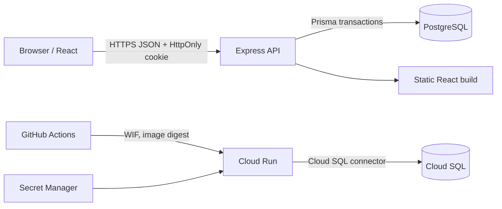
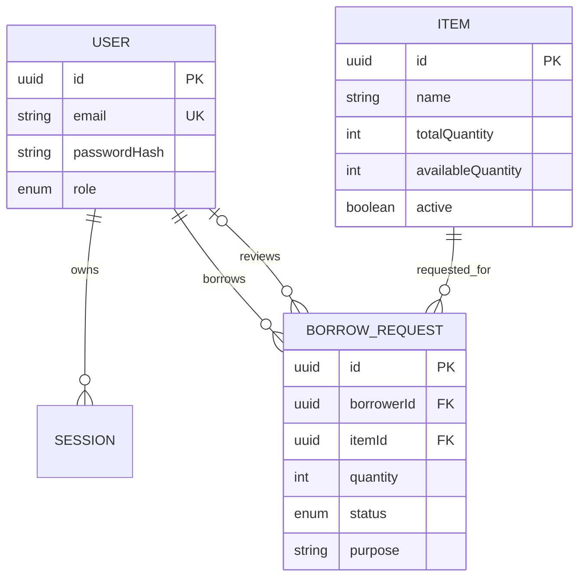

# Part C - System-Level Software Design Specification

## Architecture

The React client presents workflows and states. Express authenticates every protected request, validates input and invokes the domain service. Prisma owns persistence and transactions. Business rules that must remain valid for every client are enforced in the server domain/service layer and reinforced by database constraints.

In production, one container serves both the API and compiled React application. A separate Cloud Run job performs migrations and safe seed upserts before the service revision changes.

## Data model

`availableQuantity` has a database check constraint from zero through `totalQuantity`. Approval decrements it in the same transaction that changes request status. Return increments it in the same transaction that records `RETURNED`.

## UI conventions

- Login is the only unauthenticated screen.
- Borrowers see stock cards and only their own request history.
- Custodians see all requests and the add-item form.
- Loading, empty, success, validation and server-error states are visible.
- Destructive-looking decisions use clear labels and recorded reasons.
- Layout adapts from mobile to desktop; labels are associated with controls.

## API conventions

- JSON request/response bodies under `/api`.
- Errors use `{ "error": { "code": "...", "message": "..." } }`.
- Validation errors return 400, unauthenticated returns 401, forbidden returns 403, missing resources return 404 and rule conflicts return 409.
- `GET /api/health` checks the process; `GET /api/ready` queries PostgreSQL.

| Method and path | Borrower | Custodian | Purpose |
|---|:---:|:---:|---|
| POST `/api/auth/login` | Public | Public | Create session |
| GET `/api/auth/me` | ✓ | ✓ | Current identity |
| POST `/api/auth/logout` | ✓ | ✓ | Invalidate session |
| GET `/api/items` | ✓ | ✓ | List inventory |
| POST `/api/items` | - | ✓ | Add inventory |
| GET `/api/borrow-requests` | Own | All | List requests |
| POST `/api/borrow-requests` | ✓ | - | Create request |
| POST `/api/borrow-requests/:id/approve` | - | ✓ | Approve pending request |
| POST `/api/borrow-requests/:id/reject` | - | ✓ | Reject with reason |
| POST `/api/borrow-requests/:id/return` | Own | - | Return approved request |

## Authentication and secrets

Passwords are hashed with bcrypt. Login returns a random opaque token only in an `HttpOnly`, `SameSite=Lax` cookie; only its SHA-256 hash is stored. Production enables the `Secure` cookie flag. Logout deletes the stored session. Role and ownership are resolved from the server-side session, never from a client parameter.

Every setting is an environment variable documented in `.env.example` or the Lab 5 deployment document. Runtime secrets live in Secret Manager. GitHub authenticates to GCP with Workload Identity Federation, not a service-account JSON key.
